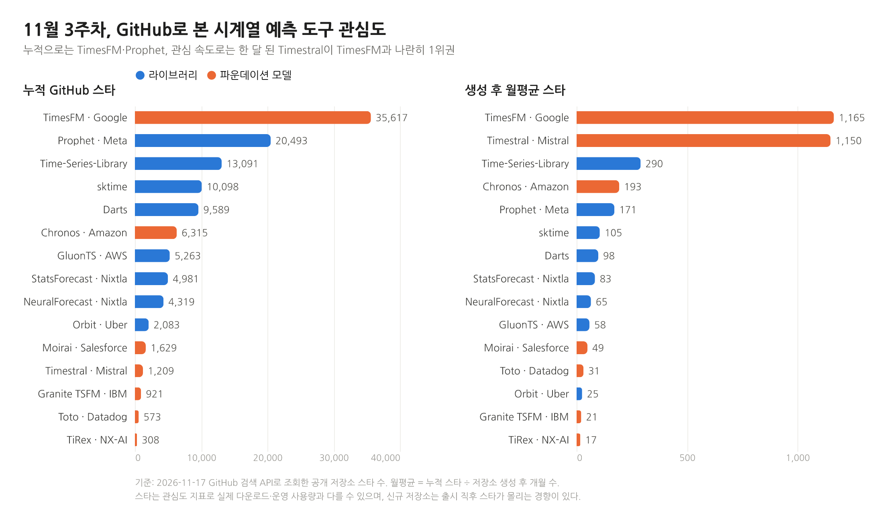

> 대상 기간 `2026.09.17 ~ 11.17`
>
> 10월 중순에 새 시계열 모델이 두 개 나왔다. 그런데 기업 쪽 소식을 모아 보니 관심은 순위보다 "우리 데이터에서 기존 시스템보다 나은가", "상업적으로 써도 되는가"에 가 있었다.

## 3줄 요약

- 10월 13일 t0-gamma, 15일 Timestral이 공개됐다. 둘 다 크기가 작고 가중치를 풀었다.
- Decathlon은 학습 없이 쓴 Chronos-2가 기존 운영 시스템과 비슷하거나 더 낫다는 결과를 얻었다.
- 해운은 연료·해빙·선박 위험 예측 실증이 잇따랐지만, 국내 선사 다수는 아직 검토 단계다.

| # | 뉴스 | 숫자 |
| :-: | --- | --- |
| 01 | 배민, 비 오기 전 라이더 수요 예측 | 우천 대응 시간 약 80% 단축 |
| 02 | Decathlon, Chronos-2 테스트 | 예측 오차 39% → 28% |
| 03 | 미스트랄 Timestral 공개 | CPU에서 10~140ms |
| 04 | t0-gamma 오픈 가중치 공개 | 미래 변수 넣으면 +6.3%p |
| 05 | 임팩티브AI 수요예측 솔루션 개편 | 판단 근거까지 기록 |

---

## 헤드라인

### 01. 배민, 비 오기 전에 라이더 수요를 예측한다

`2026.10.28` `우아콘 2026` · [바이라인네트워크](https://byline.network/2026/10/28_9281873/) · [샛이코노미](https://sateconomy.co.kr/news/view/1065578434300273)

- 비 오기 전에 라이더 수요를 예측해 우천 대응 시간을 **약 80%** 줄였다.
- 58개 지표를 쓰는 모델로 배달 시간 예측 정확도를 **2배 이상** 올렸고, 조리 시간 추천 모델의 평균 오차는 절반 가까이 줄였다.
- 어떤 모델을 쓰는지는 공개하지 않았다.

### 02. Decathlon, 학습 없이 쓴 Chronos-2가 기존 시스템과 비슷했다

`2026.10.06 보도` `원 사례 AWS 8.28` · [BERI](https://www.beri.net/article/timesfm-vs-chronos-vs-moirai-time-series-foundation-model-licence-bigquery-sagemaker-cost-2026)

- 상품 시계열 3만 9천 개로 백테스트했더니, 매주 재학습하던 기존 시스템과 비슷하거나 더 나은 결과가 나왔다.
- 파인튜닝을 하자 12주 예측 오차(WAPE)가 동남아시아에서 **39%에서 28%로**, 중남미에서 **53%에서 38%로** 내려갔다.
- 추론은 CPU 인스턴스에서 돌린다.

같은 기사는 라이선스도 정리했다. 회사 서버에 직접 올려 쓰려면 이 표부터 봐야 한다.

| 모델 | 라이선스 | 상업 이용 |
| --- | --- | --- |
| Chronos-2 | Apache 2.0 | 가능 |
| TimesFM 3.0 | 가중치 비상업용 | BigQuery를 통해서만 |
| Moirai 2.0 | 비상업용 | 불가 |

### 03. 미스트랄, 첫 시계열 모델 Timestral 공개

`2026.10.15` · [AI Balkans](https://aibalkans.com/news/global-ai/mistral-releases-timestral-for-ai-powered-forecasting) · [Laurence Moroney](https://laurencemoroney.com/2026/10/16/timestral-time-series-foundation-models.html)

- 크기는 5M, 28M, 123M, 209M 네 가지다. 미스트랄은 209M이 GIFT-Eval, TIME, fev-bench에서 사전학습 zero-shot 모델 중 1위라고 밝혔다. 자체 발표다.
- 미스트랄이 잰 바로는 8스레드 CPU에서 5M이 10ms, 209M이 140ms 걸린다. GPU가 없어도 쓸 만한 속도다.
- 월매출 2,000만 달러가 넘는 기업은 별도 라이선스가 필요하다([Eden AI](https://www.edenai.co/post/time-series-foundation-models-explained-timestral-vs-timesfm-3-in-production), 11.03 기준).

### 04. The Forecasting Company, t0-gamma 가중치 공개

`2026.10.13` `선행 논문 9.21` · [The Forecasting Company](https://www.theforecastingcompany.com/) · [arXiv](https://arxiv.org/abs/2609.24559)

- 라이선스는 Apache 2.0이다.
- 9월 논문에 따르면 기상 예보처럼 미리 알 수 있는 미래 값을 같이 넣었을 때 30개 과제에서 성능이 **6.3%p** 올랐다.

### 05. 임팩티브AI, 수요예측 솔루션에 "결정 기록" 기능 추가

`2026.10.21` `보도자료` · [스페셜타임즈](https://www.specialtimes.co.kr/news/articleView.html?idxno=476593)

- 딥플로우 포어캐스트를 개편했다. 영업팀 판매계획과 AI 예측값을 나란히 놓고, 행사 일정 같은 현장 정보를 더해 생산·발주 수량을 정하게 했다.
- 누가 어떤 근거로 수량을 정했는지 시스템에 남는다.

---

## 해운·물류 쪽 소식

해운 쪽에서는 수요보다 연료, 해빙, 선박 위험, 접안 시간을 예측하는 사례가 많았다.

#### `11.17` DNV · 연료와 탄소를 같이 줄이는 AI

선박 센서·운항 데이터를 AI로 분석해 연료·전력 사용을 최적화하는 흐름을 소개했다. 배출 관리 플랫폼은 6만 5천 척 이상과 연결할 수 있다. [ZDNet Korea](https://zdnet.co.kr/view/?no=20261117093217)

예측 대상 `연료 소비` `탄소 배출`

#### `11.15` UNIST 연구팀 · 북극 해빙 예측 AI '아이스네스트'

6.25km 구역별로 최대 30일 앞까지 해빙을 예측한다. 통항 종료일 오차를 3.5일에서 2.75일로 줄였다. [KPI뉴스](https://www.kpinews.kr/newsView/1065584546072810)

예측 대상 `북극항로 해빙 분포`

#### `11.11` 머스크 · 해양모빌리티 국제포럼 발표

연간 25억 건이 넘는 IoT 데이터를 처리하고, 접안 가능 시간을 예측해 운항 속도를 조절한다. [한국해사주간](https://www.monthlymaritimekorea.com/news/articleView.html?idxno=58120)

예측 대상 `연료 소비` `운항 위험` `접안 가능 시간` `공급망 지연`

#### `10.28` 해양수산부 · 해양수산 AX 전략

2030년까지 해양사고 인명피해 30% 감소를 목표로 내걸었다. [데일리안](https://www.dailian.co.kr/news/view/1707076/%ED%95%B4%EC%9A%B4%ED%95%AD%EB%A7%8C%EC%88%98%EC%82%B0-AI-%EC%A0%84%EB%A9%B4-%EB%8F%84%EC%9E%85%EC%9E%90%EC%9C%A8%EC%9A%B4%ED%95%AD%EC%84%A0-2026)

예측 대상 `공급망 위험` `수산물 수급` `해양 생태계 변동`

#### `10.26` 천경해운 · 운항 선박으로 AI 위험 예측 실증

영상·기상·선박 거동 데이터를 묶어 선박의 위험을 미리 잡는다. [머니투데이](https://www.mt.co.kr/industry/2026/10/26/2026102609572162742)

예측 대상 `선박 거동 위험`

#### `10.16` 한국해운협회 부산본부 · 국적 컨테이너선사 12곳 설문

상당수가 아직 AI 도입을 검토하거나 시험 중이다. 데이터 표준화와 전문 인력 부족이 걸림돌로 꼽혔다. [ZDNet Korea](https://zdnet.co.kr/view/?no=20261016112947)

---

## 숫자로 보는 관심도

다운로드 수 대신 GitHub 스타로 비교해 봤다(11.17 기준). 누적은 TimesFM(3만 5천)과 Prophet(2만)이 많고, 월평균으로 나누면 나온 지 한 달 된 Timestral이 TimesFM과 거의 같다.

스타가 많다고 현업에서 많이 쓰는 건 아니라서, 다음에는 다운로드 수도 같이 볼 생각이다.

---

## 출처

날짜는 각 페이지에 표기된 게재일 또는 발표일이다.

- `11.17 조회` 관심도 그래프 — GitHub 검색 API로 저장소별 스타 수와 생성일 집계
- `11.17` [ZDNet Korea: 친환경 선박의 숨은 무기 AI…연료비·탄소배출 동시에 줄인다](https://zdnet.co.kr/view/?no=20261117093217)
- `11.15` [KPI뉴스: UNIST, 북극항로 선박운항 돕는 AI 개발](https://www.kpinews.kr/newsView/1065584546072810)
- `11.11` [한국해사주간: 2026 첨단 해양모빌리티 국제포럼](https://www.monthlymaritimekorea.com/news/articleView.html?idxno=58120)
- `11월 초` [Eden AI: Timestral vs TimesFM-3 in Production](https://www.edenai.co/post/time-series-foundation-models-explained-timestral-vs-timesfm-3-in-production) (라이선스 11.03 기준)
- `10.28` [바이라인네트워크: 아직 들어오지 않은 주문 예측까지…배민이 꿈꾸는 도시](https://byline.network/2026/10/28_9281873/)
- `10.28` [샛이코노미: 배민, AI로 배달시간 예측](https://sateconomy.co.kr/news/view/1065578434300273)
- `10.28` [데일리안: 해운·항만·수산 AI 전면 도입](https://www.dailian.co.kr/news/view/1707076/%ED%95%B4%EC%9A%B4%ED%95%AD%EB%A7%8C%EC%88%98%EC%82%B0-AI-%EC%A0%84%EB%A9%B4-%EB%8F%84%EC%9E%85%EC%9E%90%EC%9C%A8%EC%9A%B4%ED%95%AD%EC%84%A0-2026)
- `10.26` [머니투데이: 천경해운, AI 선박 위험 예측 실증 착수](https://www.mt.co.kr/industry/2026/10/26/2026102609572162742)
- `10.21` [스페셜타임즈: 임팩티브AI 딥플로우 포어캐스트 개편](https://www.specialtimes.co.kr/news/articleView.html?idxno=476593)
- `10.16` [ZDNet Korea: 데이터·인력 부족에 막힌 해운 AI 전환](https://zdnet.co.kr/view/?no=20261016112947)
- `10.16` [AI Balkans: Mistral Releases Timestral](https://aibalkans.com/news/global-ai/mistral-releases-timestral-for-ai-powered-forecasting)
- `10.16` [Laurence Moroney: Timestral and the Quiet Power of Time-Series Foundation Models](https://laurencemoroney.com/2026/10/16/timestral-time-series-foundation-models.html)
- `10.13` [The Forecasting Company: Introducing t0-gamma](https://www.theforecastingcompany.com/)
- `10.06` [BERI: Chronos-2 Is the Self-Host Pick in TimesFM vs Chronos vs Moirai](https://www.beri.net/article/timesfm-vs-chronos-vs-moirai-time-series-foundation-model-licence-bigquery-sagemaker-cost-2026)
- `09.21` [arXiv: t0, A Time-Series Foundation Model for Forecasting with Context](https://arxiv.org/abs/2609.24559)

---

다음 주는 회귀다. 시계열 → 회귀 → 분류 → 이상 탐지 순서로 돌아가며 쓴다.
